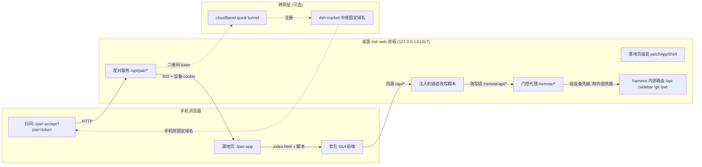
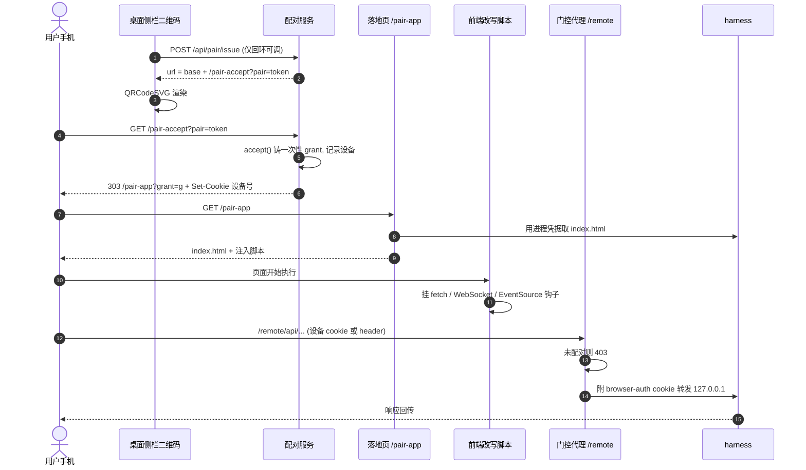
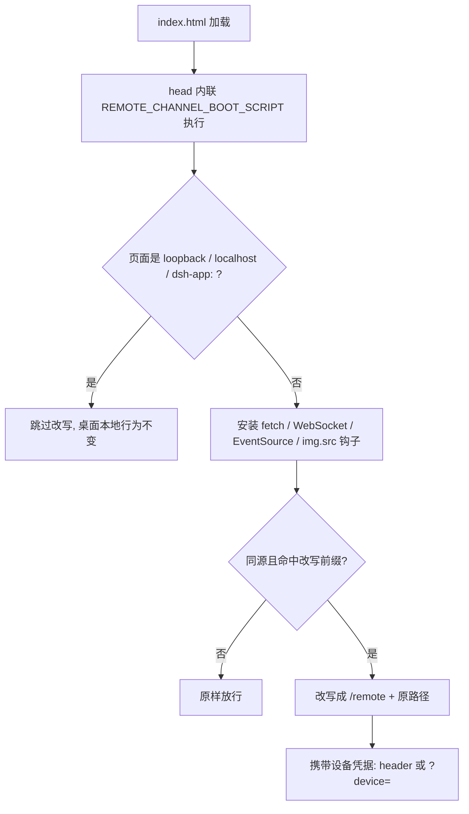
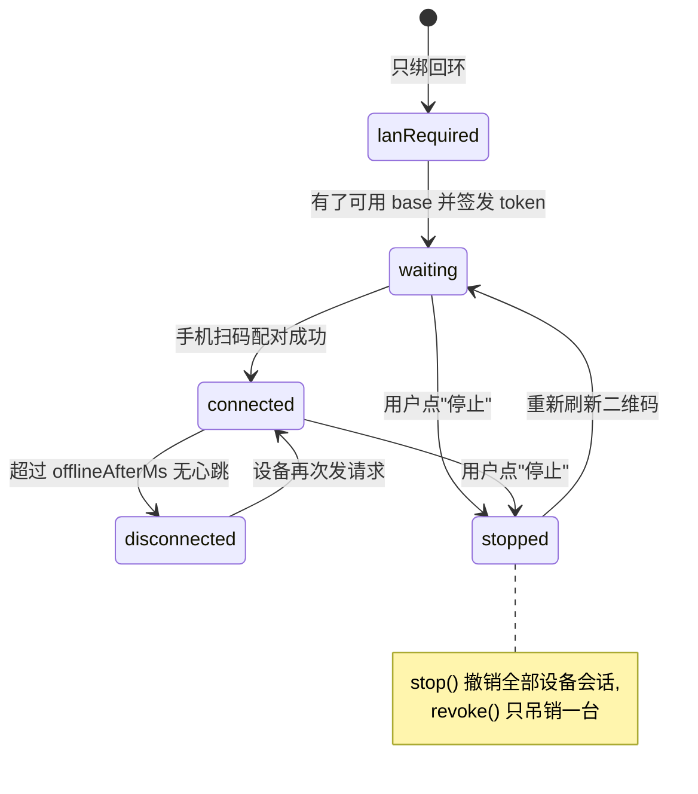

# dsh 手机连接插件架构分析：@linxin666/dsh-remote-web-ui

> 分析日期：2026-10-23 · 分析对象：`@linxin666/dsh-remote-web-ui` v0.4.8 · 运行环境：Windows，DSH Desktop profile `desktop`，监听 `127.0.0.1:61317`

**一句话结论**：它没有自定义协议，也没有独立的 App。手机用浏览器扫一个二维码，换到一枚长期的"设备 cookie"，页面里提前注入的脚本会把所有业务请求从 `/api/*` 改写成插件自己的 `/remote/*` 门控通道；插件校验设备 cookie 后，带着桌面进程自己的凭据转给本机 harness——所以手机看到的是完整的官方 GUI，而不是一个功能被裁掉的远程桌面。

## 结论速览

- 插件包：`@linxin666/dsh-remote-web-ui`，profile 装配在 `C:\Users\28135\.dsh\profiles\desktop\package.json`，配置见同目录 `cordis.patch.yml`（`lanBind: true` + 受管 `webserver` 块）。
- 连接四件套：**二维码 → 一次性 grant → 设备 cookie → `/remote` 门控代理**。二维码只承载一枚短期 token，配对成功后手机拿到的是设备身份，不是 token。
- 手机能"正常使用"GUI 的关键：host 侧通过 `webserver/index-inject` 把 `REMOTE_CHANNEL_BOOT_SCRIPT` 内联进每个 `index.html` 的 `<head>`，在任何 boot entry 之前挂上 fetch/WebSocket/EventSource 钩子（`src/index.ts:1137-1153`）。
- `/remote` 通道的门控是**无条件**的（未配对一律 403），因为代理会附带进程自身的 browser-auth 凭据，等于权限放大器（`src/remote-api.ts:14,153-158`）。
- 本机当前**手机连不上**：服务器只绑 `127.0.0.1`，配对状态为 `lan-required`；`lanBind: true` 被桌面宿主的显式 `--host 127.0.0.1` 压过（见第 8 节实测）。

## 1. 插件定位与安装位置

| 项目 | 值 |
|---|---|
| 包名 / 版本 | `@linxin666/dsh-remote-web-ui` / `0.4.8` |
| 安装路径 | `C:\Users\28135\.dsh\profiles\desktop\node_modules\@linxin666\dsh-remote-web-ui\` |
| 源码可读性 | `src/` 为 TypeScript 源码（非压缩产物），`lib/` 为构建结果 |
| 装配方式 | profile `bundles` 引入；cordis 插件 `name = 'remote-web-ui'`，`inject = ['webServer', 'typertGateway', 'connection']`（`src/index.ts:80-83`） |
| 客户端注入 | `@deepseek-ai/dsh-client-connection`、`-ui-settings`、`-ui-sidebar` |
| 关键依赖 | `cloudflared@^0.7.3`（自带隧道二进制）、`qrcode.react`（SVG 二维码）、`zod`、`yaml` |
| 配置项 | `tokenTtlMs` `offlineAfterMs` `maxDevices` `idleExpireMs` `cookieName` `requirePairingForLan` `trustedHosts` `devicesFile` `enabled` `lanBind` `pairingSource` `publicBaseUrl` `autoTunnel` `tunnelToken` `relay` `profile`（`src/index.ts:96-220`） |

## 2. 总体架构



组件职责：

| 组件 | 源码 | 职责 |
|---|---|---|
| 配对服务 | `src/pairing.ts`、`src/pair-grant.ts` | token 签发/消费、设备会话、快照与撤销 |
| 路由与页面 | `src/routes.ts` | `/api/pair/*`、`/pair-accept`、`/pair-app`、`/pair-app.sw.js`、`/pair-ping` |
| 落地页组装 | `src/routes.ts:338` `patchAppShell` | 用内部凭据取官方 index，插脚本后返回给手机 |
| 通道改写（host 注入） | `src/remote-channel-boot.ts:40` | 生成内联 boot 脚本，`<head>` 里先行安装钩子 |
| 通道规则 | `src/remote-channel-rules.ts` | 哪些前缀改写、哪些留在物理本地（前端与 boot 共用同一张表，防漂移） |
| 门控代理 | `src/remote-api.ts` | 设备凭据校验 + HTTP/WebSocket 转发 |
| 本地回环守卫 | `src/gate.ts:70` | `api/gate` 监听器（本 cohort 无 emitter，见第 9 节） |
| LAN 绑定与防火墙 | `src/lan-bind.ts`、`src/lan-bind-plan.ts`、`src/firewall.ts` | 写受管 patch 块、netsh 放行规则 |
| 隧道 | `src/tunnel.ts`、`src/relay-registry.ts` | quick tunnel / 命名隧道 / 中继注册 |

## 3. 配对时序



### 3.1 铸码：`POST /api/pair/issue`

- 只接受回环请求（`isTrustedApiRequest`），桌面面板调它，返回 `{ url, ... }`。
- `url` 的 base 由三档决定：`service.publicBaseUrl`（隧道/手工公网地址）→ 已广告的 LAN 字面量 → 都没有则拒绝，返回 `code: 'lan-required'`（`src/routes.ts:827-832`、`src/pairing.ts:636`）。
- 同一时刻只有一枚有效 token：刷新二维码即作废旧链接；token 过期时间由 `tokenTtlMs` 控制。

### 3.2 兑码：`GET /pair-accept?pair=<token>`

- 手机面对的是"扫码栅栏"：只放行 loopback、已广告的 LAN 字面量、公网 host（`publicBaseUrl`/隧道域名）、`trustedHosts`，以及已配对设备所在的私有 LAN host（动态信任）。
- `accept(token)` → 铸造 256bit 一次性 grant（TTL 60s，先删后查以防重放）。
- 响应是 `303` 到 `/pair-app?grant=<g>`，并 `Set-Cookie` 设备 cookie（`max-age` 365 天；只有请求带 `x-forwarded-proto: https` 时才加 `Secure`）。见 `src/routes.ts:1022`。

### 3.3 落地页：为什么 `/pair-app` 必须免认证

harness 对 `/` 的响应是 `401 dsh web authentication required; reopen the URL printed by dsh web.`（第 8 节实测），手机没有、也不该有 harness 的浏览器登录凭据。因此插件自己扮演"取壳"角色：

1. 用进程自身的凭据（`innerAuth`，来自 `ctx.connection.authenticatedUrl()`）从 `http://127.0.0.1:<port>/` 取官方 `index.html`，缓存 30s。
2. `patchAppShell(html, deviceId, lanHop)`（`src/routes.ts:338`）在 `<head>` 后插入 `appShellCaptureScript`：把设备号写进 `sessionStorage['dsh-remote-device']`、`history.replaceState` 把地址栏归位到 `/`、置 `window.__DSH_REMOTE_HOST_GRANT__ = true`、https 下注册 `/pair-app.sw.js` service worker。
3. 返回给手机的是"带身份的正常首页"，全程不经 harness 的认证中间件。

## 4. 手机如何看到完整的 GUI：通道改写

这是整个插件最巧的一处：不 patch 官方前端代码，而是在**页面控制之前**改写网络原语。



改写规则（`src/remote-channel-rules.ts`）：

| 前缀 | 处理 |
|---|---|
| `/api/` `/sidebar/` `/git/` `/pet/` | 改写到 `/remote<原路径>` |
| `/api/pair/` `/api/update/` `/api/plugin-manager/` | 物理本地，绝不进通道 |
| 其余同源请求 | 原样放行 |

配套动作：`WebSocket` 用 `?device=<id>` 传身份（因为 WS 不能自定义 header）；`src` 钩子只改写图片，避免 DOM hook 把 `` 误当 `<script>`；发布 `__DSH_FILE_UPLOAD__` 让插件后台上传走主线程 fetch；设置 `__DSH_TRANSPORT__.ownsHost = true` 让官方 UI 进入 "host 模式"（设置、凭据、预设等能力全开）；附带 boot watchdog——15s 内没看到对话界面就自动 reload 一次。

### 4.1 `/remote` 门控代理

- 路由：`{ kind: 'prefix', path: '/remote' }`（`src/index.ts`）→ `src/remote-api.ts`。
- 身份：`pairedDeviceIdOf()` 先看 cookie、再看 `REMOTE_DEVICE_HEADER`（WebSocket 看查询串）。
- 未配对：`403 invalid-request 'unpaired'`（`src/remote-api.ts:158`），**无开关可绕**。理由写在文件头（`src/remote-api.ts:14`）：这个通道会给你附带进程的 browser-auth 凭据，放行未配对调用等于把整套 API 暴露出去。
- 转发：`proxyLoopbackHttp()` 把请求发到 `127.0.0.1:<port>`，附内部 cookie、丢弃 Origin 与来电 cookie、重写 Host、补同源标记；`loopbackOnlyDenial()`（`src/remote-api.ts:122`）仍把 `/api/pair/*`、`/api/update/*`、`/api/plugin-manager/*` 挡在本地。
- WebSocket：`REMOTE_UPGRADE_PATHS` 覆盖 `/api/remote.mux`、`/sidebar/ws/terminal`、`/sidebar/ws/agent-terminals`、`/sidebar/ws/agent-opens`、`/api/dsh-ssh/terminal`；转发前删除 `device` 查询参数，不泄漏给上游。

## 5. 设备会话生命周期



| 关注点 | 实现 |
|---|---|
| 相位 | `lan-required` / `stopped` / `waiting` / `connected` / `disconnected`（`src/pairing.ts:32-45`），面板据此渲染 |
| 持久化 | 默认 `$DSH_HOME/remote-web-ui-devices.json`（0600，原子写） |
| 清理 | `idleExpireMs` 默认 30 天；`maxDevices` 满时淘汰最旧 |
| 撤销 | `revoke(id)` 单台；`stop()` 全清；下一次请求即 403 |
| 在线判定 | `lastSeenAt` 与 `offlineAfterMs` 比较，每条门控请求都会刷新 |

## 6. 手机端体验适配

`src/client/mobile-adapt.ts` 只在竖屏 + 粗指针 + 视口 < 1100px 时接管，不碰浏览器签名（避免误伤触屏笔记本）：

- 注入语义化 CSS Modules 后缀样式（不依赖官方哈希类名）；
- 可拖拽的小鲸鱼入口按钮悬浮，点击开关侧栏；
- 左滑收起侧栏、右滑展开、长按出菜单；
- 输入框内 Enter 只换行（手机键盘没有 Shift+Enter）；
- 隐藏桌面专用的插件面板；
- 逃生舱：`sessionStorage['dsh-remote-force-desktop'] = '1'` 可退出竖屏模式。

## 7. 四种跨网形态

| 形态 | 配置 | 二维码 base | 适用 |
|---|---|---|---|
| 纯 LAN | `lanBind: true`（需 webserver 真绑 LAN 或 0.0.0.0） | `http://192.168.1.2:<port>` | 同一 Wi-Fi，最低延迟 |
| quick tunnel | `autoTunnel: true` | `https://xxx.trycloudflare.com` | 任意网络；域名每次重启都变，需重扫 |
| quick tunnel + 中继 | `autoTunnel: true` + `relay: true`（默认） | `https://<id>.dsh-market.com` | 任意网络且域名固定，书签/cookie 可复用 |
| 命名隧道 | `tunnelToken` + `publicBaseUrl` | 自己的固定域名 | 有 Cloudflare 域名，长期稳定 |

补充细节：中继只接受指向 `*.trycloudflare.com` 的注册目标，注册信息落在 `$DSH_HOME/remote-web-ui-registry/`（256bit 密钥）；落地页还能通过 `/pair-ping`（204/403，无凭据无状态）探测 LAN 候选，把手机从公网源自动切到 `http://<lan-ip>:<port>/pair-app?grant=...`，避免走隧道绕远。

## 8. 本机实测：为什么现在手机连不上

### 8.1 现场

| 观测 | 值 |
|---|---|
| 宿主进程 | `DeepSeek Harness.exe … dsh-desktop-host/lib/index.js … app.asar\dsh C:\Users\28135\.dsh\profiles\desktop`（桌面宿主，不是 `dsh web` CLI） |
| 监听 | `127.0.0.1:61317`（PID 28920），仅回环 |
| LAN 地址 | `192.168.1.2/24`（WLAN） |
| 设备记录 | 无 `remote-web-ui-devices.json`、无 `remote-web-ui-registry\` → 从未配对过 |
| 隧道 | 未配置 `publicBaseUrl`、`autoTunnel` 未开 → 无公网 base |

### 8.2 证据

```powershell
PS> curl.exe -s http://127.0.0.1:61317/api/pair/status
{"ok":true,"paired":false,"requirePairingForLan":true,"phase":"lan-required",
 "lanAvailable":false,"lanAddresses":[],"deviceCount":0,"onlineCount":0}

PS> curl.exe -s http://127.0.0.1:61317/api/pair/lan-bind
{"ok":true,"profile":"desktop","setting":true,"blockHost":"127.0.0.1","bindHost":"127.0.0.1",
 "port":61317,"lanUrls":[],"firewall":{"ok":true,"managed":true,"note":"netsh"},"platform":"win32",
 "desiredHost":"127.0.0.1","wildcardSupported":false,"supportedHosts":["192.168.1.2"],
 "lanBlocked":false,"pendingRestart":false}

PS> curl.exe -s -o NUL -w "%{http_code}" http://192.168.1.2:61317/api/pair/status
000                      # 连不上：没有监听在 LAN 地址

PS> curl.exe -s -o NUL -w "%{http_code}" http://127.0.0.1:61317/
401                      # dsh web authentication required; reopen the URL printed by dsh web.
```

### 8.3 根因

`desiredBindHost(lanBind, startupHost, capability)` 的优先级是：**开关关 → 钉 `127.0.0.1`；开关开 → 显式 `--host` 只要宿主接受就优先；否则 0.0.0.0（宿主支持通配时）；再否则首个 LAN 候选**（`src/lan-bind-plan.ts:94-114`，调用点 `src/index.ts:917`）。

实测 `setting: true` 而 `desiredHost: 127.0.0.1`、`wildcardSupported: false`、`supportedHosts: ["192.168.1.2"]`：按该函数的语义，走到 `127.0.0.1` 只有一种可能——宿主启动时带了被接受的显式 `--host 127.0.0.1`，它压过了开关（否则应当落到 `supportedHosts[0]`）。于是受管块被钉在回环，`pendingRestart` 为 `false`（插件认为已经同步），面板上的开关因此「看起来开着却不起作用」。

`cordis.patch.yml` 里的受管块因此长这样：

```yaml
- id: webserver
  config:
    host: '127.0.0.1'   # ← 生效的是这一行
    port: 0
    compression: gzip
```

### 8.4 三条打通路径

1. **换 standalone 实例**（最直接）：用 DSH CLI 另起一个端口给手机用，避免和桌面宿主抢 61317。插件文档给出的旗标就是 `--host` / `--port`：
   ```powershell
   dsh web --host 192.168.1.2 --port 61234
   ```
   要点：profile 必须是装了本插件的那个（桌面 App 用的是 `desktop`，CLI 默认可能是 `web`），否则这个实例上根本没有配对页面。插件会自动加 `netsh` 规则；手机扫码地址为 `http://192.168.1.2:61234/pair-accept?pair=…`。注意 61317 的桌面实例仍不能被手机访问。
2. **开隧道**（推荐，任意网络可用）：设置卡片打开 `autoTunnel`，插件自带 `cloudflared` 起 quick tunnel；保持 `relay` 默认开启可获得固定 `https://<id>.dsh-market.com`。
3. **自建隧道**：已有公网隧道/反代时填 `publicBaseUrl`（并把它加进 `trustedHosts`，反代场景常见）。

### 8.5 打通后的验证清单

| 检查 | 期望 |
|---|---|
| `GET /api/pair/status` | `phase` 变 `waiting`，`lanAvailable: true` |
| 手机落地页 | `sessionStorage['dsh-remote-device']` 有值；地址栏归位到 `/` |
| DevTools Network | `/remote/api/...` 返回 200，而非 403 `unpaired` |
| 桌面 `/api/pair/status` | `deviceCount: 1`、`onlineCount: 1` |
| 刷新/断网重连 | service worker 重新取壳，cookie 仍有效 |

## 9. 安全边界与已知缺口

| 项 | 现状 | 影响 |
|---|---|---|
| `api/gate` 监听器 | 本 cohort（0.1.2-alpha.2 线）官方 runtime **没有 emitter**，`src/gate.ts` 永不触发 | 直连 `/api` 由 harness fence + browser-auth cookie 把关，配对强制只作用于 `/remote` |
| `/remote` 门控 | 无条件强制，`requirePairingForLan=false` 也不放松 | 但通道附带进程凭据，等于把 harness 的 API 放大器交到已配对设备手里 |
| 凭据吊销 | `stop()`/`revoke()` 只清设备会话（设备 cookie 本身 365 天有效，随撤销一起失效） | 设备此前经 harness 兑换到的 browser-auth 凭据不会被吊销，只能等它自然过期（约 30 天）；这是本 cohort 最实际的风险点 |
| WebSocket 身份 | `?device=<id>` 走查询串 | 可能进访问日志/边缘日志（计划改一次性票据） |
| 代理头判定 | 带 `CF-Connecting-IP` / `X-Forwarded-For` 一律视为远程（issue #1906） | 反代后"本地"请求不再享受回环豁免，属预期 |
| cookie `Secure` | 仅 `x-forwarded-proto: https` 时加 | 纯 HTTP LAN 下 cookie 可被同网嗅探（HTTP 本身的固有限制） |
| 一次性 grant | 60s、先删后查 | 防重放，但二维码截图窗口内仍可被抢注 |

## 10. 排障速查

| 症状 | 先看 | 处理 |
|---|---|---|
| 二维码不出现，提示"需要局域网" | `GET /api/pair/status` 的 `phase` | `lan-required` → 按 8.4 换绑定或开隧道 |
| 手机扫码 404/403 | `GET /pair-accept` 是否 200 | 检查 `trustedHosts`、`publicBaseUrl` 是否与手机地址一致 |
| 落地页白屏 | 注入脚本是否执行、SW 是否注册成功 | 清站点数据重扫；确认页面不是 loopback 源 |
| 页面能开但数据不加载 | DevTools 里 `/remote/*` 的状态码 | 403 `unpaired` → cookie 丢失/被清；重扫码 |
| 手机里终端/文件不可用 | WS 路径是否在 `REMOTE_UPGRADE_PATHS` | 跨版本插件可能未覆盖新 WS 路由，需升级插件 |
| 重启后要重扫 | 是否 `autoTunnel` 且 `relay` 关闭 | 固定域名需 `relay: true` 或 `tunnelToken` + `publicBaseUrl` |
| 反复被打回登录 | 手机是否在公网源访问而 LAN 可达 | 保留 `/pair-ping` 自动切换，勿手改地址 |

## 附录 A：源码索引

| 关注点 | 位置 |
|---|---|
| 插件名与注入依赖 | `src/index.ts:80-83` |
| Config 全字段与语义 | `src/index.ts:96-220` |
| LAN 绑定应用点 | `src/index.ts:917`、`src/lan-bind-plan.ts:94-114` |
| head 注入（uuid polyfill / boot script） | `src/index.ts:1137-1153` |
| boot 脚本生成 | `src/remote-channel-boot.ts:40` |
| 改写规则表 | `src/remote-channel-rules.ts` |
| 兑码 303 | `src/routes.ts:1022` |
| 落地页组装 | `src/routes.ts:338`、`src/routes.ts:1099` |
| 门控代理与 unpaired 403 | `src/remote-api.ts:14,122,158` |
| `lan-required` 判定 | `src/pairing.ts:636`、`src/routes.ts:827-832` |
| 相位定义 | `src/pairing.ts:32-45` |
| 回环客户端判定 | `src/gate.ts:70-76` |
| 防火墙（Windows netsh） | `src/firewall.ts:56-74` |
| 隧道管理 | `src/tunnel.ts`、`src/tunnel-plan.ts`、`src/relay-registry.ts` |
| 移动端适配 | `src/client/mobile-adapt.ts` |

## 附录 B：术语

- **token**：二维码里的配对票据，短期、只保留一枚，刷新即作废。
- **grant**：兑码成功后的一次性跳转票据，60s 内有效，换完即焚。
- **设备 cookie / 设备身份**：手机长期凭据，也是 `/remote` 门控的判定依据。
- **门控代理（`/remote`）**：把手机请求变成"带桌面凭据的本机请求"的受控出口。
- **受管块（managed block）**：插件写进 `cordis.patch.yml` 的 `webserver` 配置段，仅在 `lanBind` 被显式设置后维护。
